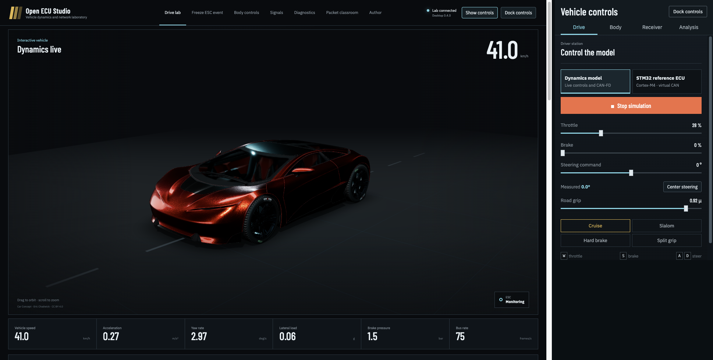

# Open ECU Studio

Open ECU Studio is a software-only automotive classroom. Drive a 3D car, change a light or steering input, and trace that change from a CAN frame’s raw bytes to its decoded value. The browser app and Apple Silicon desktop app use the same lab. All identifiers and the STM32 firmware were created for this project.

[Open the live web classroom](https://ecu-studio.anir0y.in)



## Run the browser app

On macOS or Linux, install Python 3.11+, Node.js 22.12+ in the 22.x line, and pnpm 12. From a terminal, run the following commands.

```sh
git clone https://github.com/anir0y/open-ecu-studio.git
cd open-ecu-studio
python3 -m venv .venv
.venv/bin/python -m pip install -e '.[ui,test]'
pnpm --dir ui install --frozen-lockfile
pnpm --dir ui build
.venv/bin/ecu-can-ui --interface virtual --channel studio --host 127.0.0.1 --port 8765
```

Open the local console, wait for **Lab connected**, select **Dynamics model**, then choose **Start simulation** and **Cruise**. The speed readout and frame counter should rise. [Open the local console](http://127.0.0.1:8765)

## Try a first lesson

| What you want to see | What to do |
| --- | --- |
| A steering command in bytes and degrees | In **Packet classroom**, select the **Right turn** worked example and highlight the steering field. Compare its two bytes with the decoded angle. |
| An ECU reacting to wheel slip | Select **STM32 reference ECU** while stopped. In **Freeze ESC event**, choose **Arm for first slip**, then start the simulation. Compare the four wheel speeds, brake pressure and ESC status at the trigger. Download the event worksheet. |
| A switch changing the car and its packet | In **Dynamics model**, open **Body controls** and select a turn signal or open a door. Inspect the resulting body status frame. |
| Your own signal definition | In **DBC workbench**, load the teaching example or import a `.dbc` file. Change a physical value, inspect its encoded bytes, and open the packet in **Packet classroom**. |
| A presentation for a class | Choose **Detach controls**. Operate the model in the small window while students watch the car and telemetry. **Dock controls** returns the controls to the main window during the same run. |

## Guides

| Guide | In this checkout | On the GitHub Wiki |
| --- | --- | --- |
| Installation, desktop packaging, Docker CLI and optional Linux virtual CAN | [Installation](docs/wiki/Installation.md) | [Installation wiki](https://github.com/anir0y/open-ecu-studio/wiki/Installation) |
| Driving, packet reading, worksheets, firmware and classroom presentation | [Usage](docs/wiki/Usage.md) | [Usage wiki](https://github.com/anir0y/open-ecu-studio/wiki/Usage) |

## How the lab works

The React and Three.js frontend sends control changes to a local Python server. A WebSocket carries observed frames and decoded state back to the display. The default network is an in-memory `python-can` bus. A Linux VM can use a kernel-backed `vcan` interface for observation with SocketCAN tools.

The dynamics model emits classical CAN and a 16-byte CAN FD telemetry frame. In firmware mode, Unicorn executes the included STM32F407 ELF on a small board model. Renode is an alternative on Linux with virtual CAN. The reference ECU emits classical CAN and answers the classroom’s single-frame UDS diagnostics. All driving and ESC behavior is simulated.

The DBC workbench imports a deliberately bounded teaching subset and includes a visual builder for placing signals onto payload bytes without writing DBC syntax. It supports standard 11-bit identifiers, 1–8 byte Classical CAN messages, and byte-aligned 8–32 bit integer signals with Intel or Motorola byte order. Imported definitions and packet previews stay in the browser; this feature does not open or transmit through a CAN adapter.

The Cloudflare deployment uses a Worker and one Durable Object per browser profile for the synthetic classroom. It supports the dynamics model, controls, diagnostics, worksheets and packet tools. The public hostname is designed to sit behind Cloudflare Access with the Google identity provider, allowing any Google account while keeping the direct `workers.dev` hostname disabled. Worker-side rate limits provide a second abuse control. STM32/Unicorn firmware rehosting remains available in the desktop and local browser setups because native firmware emulation cannot run inside a standard Cloudflare Worker.

| Synthetic ID | What students can observe |
| --- | --- |
| `0x181`, `0x182`, `0x280` | Four wheel speeds, ESC dynamics and intervention status |
| `0x183`, `0x510` | Driver inputs, vehicle motion and combined CAN FD telemetry |
| `0x361`, `0x362` | Body switches, door state and simulated receiver decisions |
| `0x6A0`, `0x6A8` | Diagnostic request and response |

## Development checks

After the browser setup, run the backend and frontend checks from the repository root.

```sh
.venv/bin/python -m pytest
pnpm --dir ui check
pnpm --dir ui test
```

The simulator lives in `ecu_lab/`, the React UI in `ui/src/`, and the Electron shell in `ui/electron/`. The reference image, C source, linker script and Makefile are in `firmware/reference_ecu/`.

## Credits

Created by Animesh Roy. [Author website](https://anir0y.in/)

The 3D **Car Concept** model is by Eric Chadwick, © 2024 Darmstadt Graphics Group GmbH, licensed under CC BY 4.0. The simulator animates the wheels and lights. [Original model](https://github.com/KhronosGroup/glTF-Sample-Assets/tree/main/Models/CarConcept) · [Model license and trademark notices](ui/public/models/car-concept/LICENSE.md)
